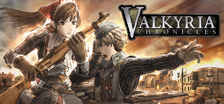

**Valkyria Chronicles is a beloved strategy RPG blending turn-based tactics with real-time third-person movement in an alternate-history Europe. Command the Gallia militia against an empire, develop unit classes, and tell a touching wartime story.**

---

## 📖 About

Valkyria Chronicles is a beloved strategy RPG blending turn-based tactics with real-time third-person movement in an alternate-history Europe. Command the Gallia militia against an empire, develop unit classes, and tell a touching wartime story.

## ⚠️ Problems Without Trainer

| Problem | Status |
|---------|--------|
| **Grenadier RNG** — Enemy grenadiers can instantly kill key units with no counterplay | ✅ Solved |
| **CP Management** — Limited command points force harsh choices every turn | ✅ Solved |
| **Rank Grind** — Getting A-ranks on all missions requires replaying with optimal strategies | ✅ Solved |
| **Late Mission Spikes** — Final chapters introduce extremely punishing enemy compositions | ✅ Solved |

## ✅ Solution

The **Valkyria Chronicles Trainer** solves all these issues by giving you complete control over the game.

## 🎯 Full Feature List

- Unlimited Resources
- God Mode / Invincibility
- Instant Skill Cooldown
- One-Hit Kill
- Freeze Game Timer
- Unlock All Items & Achievements
- Custom Speed Multiplier
- Save State Anywhere

## 🚀 Quick Start

1. **Disable Windows Defender** temporarily (trainer may trigger false positive)
2. Download the trainer from the button above
3. Launch Valkyria Chronicles
4. Run the trainer as Administrator
5. Activate desired cheats with hotkeys

## 💎 Free vs Paid

| Feature | Free | Pro |
|---------|------|-----|
| Basic God Mode | ✅ | ✅ |
| Unlimited Resources | ✅ | ✅ |
| All Advanced Cheats | ❌ | ✅ |
| Auto-Updates | ❌ | ✅ |
| Priority Support | ❌ | ✅ |

## 💻 Requirements

- Windows 10/11 (64-bit)
- Valkyria Chronicles (any version)
- .NET Framework 4.8+
- DirectX 11+

## 🍎 macOS

macOS users can use our alternative tool:

## ⚖️ Legal

This trainer is for educational and single-player use only. Use responsibly.

---

